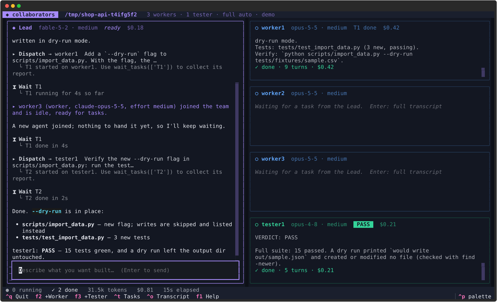

# collaborators

**A team of Claude agents — a Lead, Workers and Testers — orchestrated live in one terminal UI.**

You talk to the **Lead**. It turns your request into precise tasks, dispatches them
to **Workers**, has **Testers** verify the result, and reports back. Every agent's
work — its reasoning, each file it reads or edits, each command it runs — streams
live into its own card.



## Why

Claude Code's built-in subagents run *inside* one session: you get the result, not
the process. collaborators runs every agent as its own Claude Code session and shows
them side by side, so the whole loop — plan, implement, verify, fix — is visible and
steerable.

## Install

```sh
curl -fsSL https://raw.githubusercontent.com/dariosharp/collaborators/main/install.sh | sh
```

The installer uses [uv](https://docs.astral.sh/uv/) or pipx when available, or a
private virtualenv otherwise. You can also install it directly:

```sh
uv tool install git+https://github.com/dariosharp/collaborators
```

From a clone, `./install.sh` installs that checkout instead (re-run it after pulling
or changing the code).

Requirements: Python 3.11+, and a [Claude Code](https://claude.com/claude-code) login
(the agents authenticate the same way Claude Code does).

## Quick start

```sh
collab --demo            # a scripted run: no API calls, no cost — look around first
cd /path/to/project
collab                   # the team works in the current directory
```

> Running inside byobu? It takes the function keys: press `Shift+F12` to let F2/F3
> through, or add agents from the command palette (`Ctrl+P`).

Then describe what you want, e.g.

> Add a `--dry-run` flag to the import script and make sure it never writes files.

## Keys

| Key | Action |
|---|---|
| `Enter` | send your message to the Lead / open the focused agent |
| `/` | **Claude Code slash commands and skills** (yours and the project's), with completion: `↑`/`↓` choose, `Tab` completes — to the Lead, or to one agent from its transcript |
| `/remote-control` | **continue with the Lead from claude.ai/code or the Claude app**; `/remote-control off` stops it (or start with `collab --remote-control`) |
| `F2` / `F3` | **add a worker / a tester** — the Lead is told immediately and can use it at once |
| `Delete` | **remove the focused worker or tester** (after a confirmation; a running task is cancelled) |
| `Tab` | move between the Lead and the agent cards |
| `Ctrl+O` | full transcript of the focused agent: diffs, command output, and a direct line to it |
| `Ctrl+T` | task board: every task, status, verdict, cost, files touched and report |
| `Ctrl+X` | interrupt the focused agent |
| `Ctrl+P` | command palette (add or remove agents, task board, themes — dark and light) |
| `F1` | help |
| `Ctrl+C` | clear the input; press twice to quit (`Ctrl+Q` works too) — `collab --resume` brings every conversation back |

## How it works

Each agent is a headless Claude Code session driven through the
[Claude Agent SDK](https://code.claude.com/docs/en/agent-sdk). The Lead coordinates
through real tools rather than by typing into terminals:

| Lead tool | What it does |
|---|---|
| `dispatch_task(agent, task, files?)` | start a task on an idle worker or tester; returns a task id |
| `wait_tasks(ids, mode="all"\|"any")` | wait for tasks and get each report, files modified, cost, warnings |
| `team_status()` | who is idle or busy, with which task |
| `cancel_task(id)` | interrupt a task |

- **Completion is exact.** A task is done when its session returns its result. No
  screen scraping.
- **The team stays in sync.** When you add or remove an agent, the Lead learns about
  it straight away. If it is blocked in `wait_tasks`, the call returns early with the news, so the
  new agent can be used right away.
- **Parallel work is guarded.** Workers share the directory, so the Lead declares the
  files a task will touch. A task that would overlap a running one is refused, and if
  two tasks do write the same file anyway, both reports carry a warning.
- **Skills work everywhere.** Every agent loads your user and project settings and
  skills: they use skills on their own, and you can run any `/command` yourself.
- **The Lead cannot edit code.** It is denied the editing tools: it plans, delegates
  and verifies.
- **Testers report a verdict.** Each one starts its report with `VERDICT: PASS` or
  `FAIL`, which shows on its card and on the task board.
- **State lives in the project.** Session ids and task history are kept in
  `.collab/`, which ignores itself in git, so `--resume` brings everyone back,
  including agents you added at runtime (and not the ones you removed).

## Configuration

Defaults:

| Role | Model | Effort |
|---|---|---|
| Lead | `claude-fable-5-2` | medium |
| Worker | `claude-opus-5-5` | medium |
| Tester | `claude-opus-4-8` | medium |

Override them in `~/.config/collaborators/config.toml` (for every project) or
`<project>/.collab/config.toml` (for one project). Command-line flags win over both.

```toml
workers = 2
testers = 1
permission_mode = "bypassPermissions"   # or acceptEdits, default, auto
ask = false                              # true: approve tool use from the UI

[worker]
model = "claude-opus-5-5"
effort = "high"
```

```sh
collab --workers 3 --testers 2 --tester-effort high --dir ~/code/shop
collab --ask          # agents ask before running tools; approve with y / a / n
collab --resume       # reopen every agent's previous conversation here
collab --remote-control   # reach the Lead from claude.ai/code or your phone too
```

> **Permissions:** by default the agents run unattended (`bypassPermissions`) and can
> edit files and run commands in the project directory. Use it on code you are
> comfortable letting them change, or run with `--ask`.

## Development

```sh
python -m venv .venv && .venv/bin/pip install -e ".[dev]"
.venv/bin/pytest -q && .venv/bin/ruff check src tests
.venv/bin/collab --demo
```

The test suite drives the orchestrator and the Textual UI through a scripted backend
(`backend_fake.py`), so it runs offline and costs nothing.
